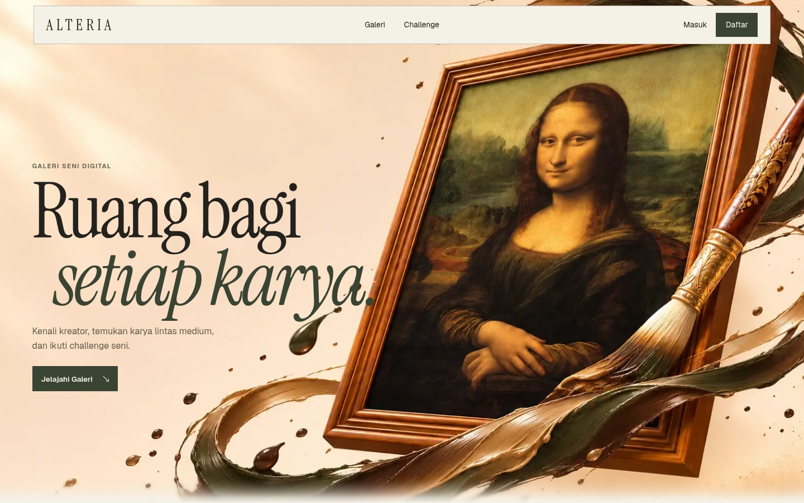

# ALTERIA

**Galeri seni digital** untuk menjelajahi karya lintas medium, memamerkan portofolio, dan mengikuti challenge seni.

[Fitur](#fitur) · [Menjalankan proyek](#menjalankan-proyek) · [Akun Admin](#akun-admin) · [Diagram sistem](#diagram-sistem)



Dibangun dengan Next.js, React, JavaScript, Tailwind CSS, dan PostgreSQL. Sharp memproses gambar unggahan sebelum aplikasi menyimpannya.

## Fitur

| Peran | Aktivitas |
| --- | --- |
| **Tamu** | Mencari, memfilter, dan mengurutkan karya di galeri. Melihat detail karya, profil kreator, komentar, dan hasil challenge. |
| **Member** | Mengelola karya, profil, dan akun sendiri. Menyukai karya, berkomentar, menyimpan karya ke **Karya Favorit**, melaporkan karya unggahan Member lain, dan mengikuti challenge. |
| **Kurator (Curator)** | Melihat status verifikasi akun. Setelah disetujui Admin, Kurator dapat mengatur jadwal dalam WITA, mengelola challenge miliknya, meninjau submisi, dan mengumumkan pemenang. |
| **Admin** | Melihat statistik, menyetujui atau menolak pendaftaran Kurator, mengelola akun dan kategori, serta menolak laporan atau menghapus karya yang dilaporkan. |

Selama challenge aktif, Member dapat mengirim satu karya miliknya dan menarik submisi sebelum tenggat. Setelah challenge berakhir, Kurator dapat menetapkan maksimal tiga pemenang. Karya peserta dan hasilnya tampil di halaman **Challenge**.

Unggahan karya, foto profil, dan banner challenge menerima JPEG, PNG, atau WebP hingga 5 MB. Aplikasi mengonversinya ke WebP dan menyimpannya di PostgreSQL.

## Menjalankan proyek

Siapkan **Node.js 20.9 atau lebih baru** dan **PostgreSQL**. Langkah database di bawah menggunakan pgAdmin.

### 1. Pasang dependensi

Jika belum punya folder proyek, klon repositori dan buka foldernya.

```sh
git clone https://github.com/mansuraidil9-cpu/Final-Project-art-showcas.git
cd Final-Project-art-showcas
```

Jalankan perintah ini dari folder proyek.

```sh
npm ci
```

### 2. Siapkan database

Buat database `alteria` di PostgreSQL. Buka **Query Tool** untuk database tersebut di pgAdmin, lalu jalankan seluruh isi [database/schema.sql](database/schema.sql). Jika sudah memiliki database ALTERIA dari versi sebelumnya, jalankan file skema yang sama untuk memperbarui struktur tabel.

Untuk mengisi galeri dan challenge dengan data contoh, jalankan [seed-artworks.sql](database/seed-artworks.sql) dan [seed-challenge.sql](database/seed-challenge.sql) setelah skema berhasil dijalankan.

### 3. Atur koneksi

Buat `.env.local` di folder yang sama dengan `package.json`. Sesuaikan nilai dengan konfigurasi PostgreSQL di komputermu.

```dotenv
PGHOST=localhost
PGPORT=5432
PGDATABASE=alteria
PGUSER=postgres
PGPASSWORD="GANTI_DENGAN_PASSWORD_POSTGRESQL"
```

Jika kata sandi di `.env.local` mengandung tanda `$`, tulis tanda itu sebagai `\$` agar Next.js membacanya sebagai karakter biasa.

### 4. Buka ALTERIA

```sh
npm run dev
```

Buka alamat **Local** yang muncul di terminal, biasanya [http://localhost:3000](http://localhost:3000).

## Akun Admin

Member dan Kurator mendaftar lewat halaman **Daftar**. Untuk membuat akun Admin, tambahkan pengaturan berikut sementara ke `.env.local`. Gunakan email yang belum terdaftar dan kata sandi pilihanmu sepanjang 8–128 karakter tanpa spasi atau karakter tak terlihat.

```dotenv
ALTERIA_ADMIN_NAME="Admin ALTERIA"
ALTERIA_ADMIN_EMAIL=admin@example.test
ALTERIA_ADMIN_PASSWORD="GANTI_DENGAN_PASSWORD_ADMIN"
```

Jalankan skrip ini dari folder proyek.

```sh
node scripts/create-admin.mjs
```

Setelah terminal menampilkan **Akun Admin ALTERIA berhasil dibuat**, hapus baris `ALTERIA_ADMIN_PASSWORD` dari `.env.local`. Buka halaman **Masuk** dan gunakan email serta kata sandi yang kamu pilih.

## Diagram sistem

- [Diagram use case](docs/diagram-use-case.svg) menunjukkan akses dan tindakan yang tersedia untuk empat peran.
- [Diagram aktivitas](docs/diagram-aktivitas.svg) menunjukkan alur dari kunjungan sebagai Tamu hingga pengguna keluar dari akun.

## Pemeriksaan proyek

```sh
npm test
npm run lint
npm run build
```

Sumber dan kredit karya contoh tercatat di [credits.json](public/alteria/credits.json).
